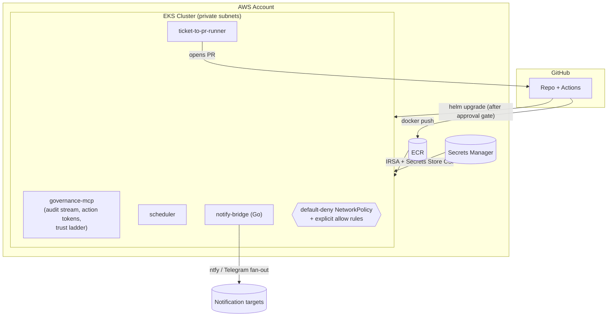

# agent-fleet-on-eks

> A reference deployment of a self-hosted **agent fleet** — a governance MCP server, a
> scheduler, a ticket-to-PR runner, and a notification bridge — running on AWS EKS,
> documented as a **customer-facing runbook** the way a platform team would actually run it.

This repository is written from the point of view of a Forward Deployed Engineer handing a
running system to an enterprise customer's platform team. It is deliberately opinionated,
reproducible, and cheap to stand up and tear down. The centerpiece deliverable is the
[runbook](./runbook/), backed by real Terraform, real Helm charts, a real CI/CD pipeline,
and a SOC 2 control mapping.

**Read [`PLAN.md`](./PLAN.md) for the full phased build plan.**

---

## What this is

A single reference deployment that demonstrates five capabilities end to end:

| # | Capability | Where it lives | Closes |
|---|------------|----------------|--------|
| 1 | Kubernetes workload orchestration (Deployments, probes, limits, default-deny NetworkPolicy) | [`charts/`](./charts/) | Gap 1 |
| 2 | Infrastructure as Code (VPC, EKS, IRSA, ECR, Secrets Manager) | [`terraform/`](./terraform/) | Gap 2 |
| 3 | CI/CD with a propose-then-approve gate (test → build → push → deploy) | [`.github/`](./.github/) | Gap 3 |
| 4 | SOC 2 Trust Services Criteria control mapping | [`compliance/`](./compliance/) | Gap 4 |
| 5 | A production service ported to Go (the notification bridge) | [`services/notify-bridge-go/`](./services/) | Gap 5 |

## Architecture



## Repo layout

```
agent-fleet-on-eks/
├── terraform/     # VPC, EKS, IAM/IRSA, ECR, Secrets Manager  (the bulk of the work)
├── charts/        # single values-driven Helm chart for all services + NetworkPolicies
├── services/      # reference services + the Go notification bridge
├── .github/       # Actions: test → build → push ECR → helm upgrade (approval-gated)
├── runbook/       # the customer-facing deployment runbook (the FDE artifact)
├── compliance/    # SOC 2 control → Trust Services Criteria mapping
├── deploy/        # per-environment Helm values (production values kept untracked)
├── scripts/       # e2e_local.py — the full trust flow proven locally, no AWS needed
├── PLAN.md        # phased build plan
└── VALIDATION.md  # what's proven locally vs. what needs a live account
```

## Cost (read before `terraform apply`)

Rough us-east-1 figures. **Tear the cluster down between work sessions.**

| Resource | Approx. rate | If left running 24×7 |
|----------|--------------|----------------------|
| EKS control plane | $0.10/hr | ~$73/mo |
| 2× `t3.medium` managed nodes | ~$0.083/hr | ~$60/mo |
| NAT Gateway | ~$0.045/hr + data | ~$33/mo |
| Load Balancer (NLB/ALB) | ~$0.0225/hr + LCU | ~$16/mo |
| Secrets Manager (~5 secrets) | $0.40/secret/mo | ~$2/mo |
| ECR / data transfer | usage-based | a few $ |
| **Total left running** | | **~$180–200/mo** |
| **Total for one ~8-hour session, then destroyed** | | **≈ $3–5** |

```bash
# Stand up
cd terraform && terraform init && terraform apply
# ... do the work ...
# Tear down (do this every time)
terraform destroy
```

## Status

Build complete through Phase 5 and validated locally end to end. The Terraform foundation,
Helm workloads with default-deny NetworkPolicies, the Go notification bridge, the CI/CD
pipeline with an approval gate, and the SOC 2 mapping + runbook are all in place. Phase 6 is
proven locally — `python scripts/e2e_local.py` drives one ticket through the whole trust flow
(scheduler → governance token → runner → PR → signed notification, all on the audit stream) —
with the timed clean-room install and the on-cluster real PR pending a live AWS account.

See [`PLAN.md`](./PLAN.md) for phase-by-phase progress, [`VALIDATION.md`](./VALIDATION.md) for
exactly what's verified versus what needs a live account, and [`runbook/`](./runbook/) for the
deployment procedure.
